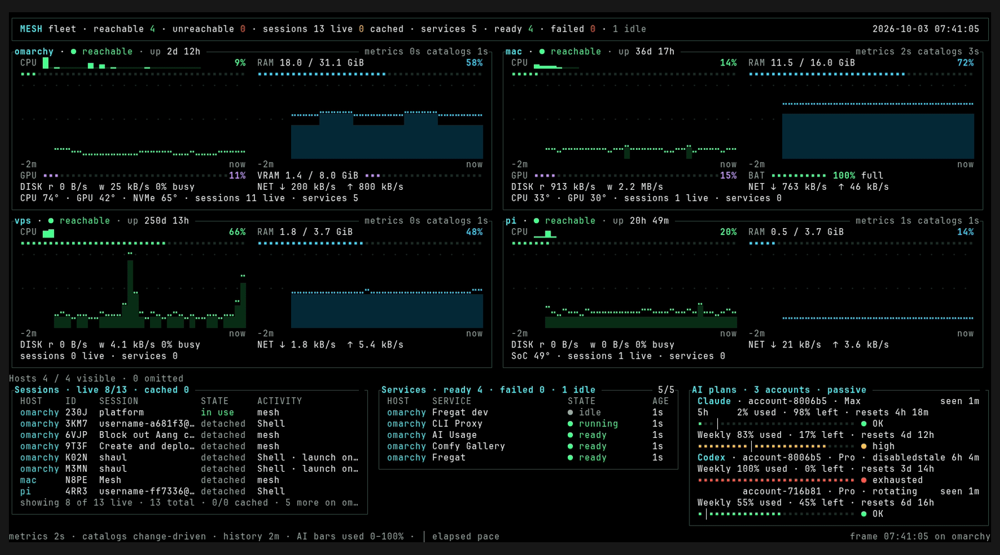
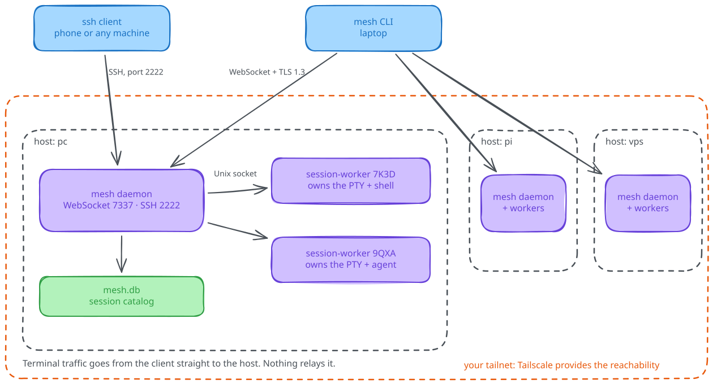

# mesh

every terminal on every machine you own, from wherever you are

[](https://github.com/ShaulLavo/mesh/actions/workflows/ci.yml)
[](https://github.com/ShaulLavo/mesh/releases)



```console
$ mesh local -- sh -c 'echo build finished; sleep 600'
new session ETRG
build finished
                                   (press ctrl+])
detached from ETRG, still running
$ mesh ls
ID    STATE     AGE  IDLE  MEM  STARTED IN  COMMAND
ETRG  detached  2s   2s    -    /tmp        sh -c echo build finished; sleep 600
$ mesh local -r
resuming ETRG
```

mesh runs terminal sessions on the machines in your tailnet and opens any of them from any other, or from your phone. a session lives on its host, so closing the laptop, switching networks or restarting the daemon does not stop the command

- **built for agents.** run claude code and codex on a desktop, a laptop, a pi and a vps. they keep working while you're away, and you pick them up from whatever is in your hand
- **one screen for everything.** the picker and `mesh dashboard` show every machine, session and agent in one place
- **direct.** terminal traffic goes from your client to the host over tailscale. nothing relays it

<picture>
  <source media="(prefers-color-scheme: dark)" srcset="docs/assets/architecture.dark.svg">
  
</picture>

*each session is its own worker process. the daemon only coordinates, so it can restart without touching a session.*

## quick start

1. install. mesh connects machines over [tailscale](https://tailscale.com/), so every machine that should talk to another needs it

   ```bash
   # mac, Apple silicon
   brew tap ShaulLavo/mesh https://github.com/ShaulLavo/mesh
   brew install --cask ShaulLavo/mesh/mesh
   mesh daemon install      # the cask installs the command, not the daemon

   # linux, amd64 or arm64 (installs and starts the user daemon)
   curl -fsSL https://raw.githubusercontent.com/ShaulLavo/mesh/main/scripts/install.sh | sh
   ```

   the linux installer asks for confirmation through [gum](https://github.com/charmbracelet/gum) v2. run `curl -fsSL https://raw.githubusercontent.com/ShaulLavo/mesh/main/scripts/install.sh | MESH_INSTALL_YES=1 sh` to skip the prompt and the gum requirement

2. try a session on this machine first. it needs no network. `ctrl+]` detaches and the shell keeps running

   ```bash
   mesh local    # new shell session
   mesh ls       # it is still there after ctrl+]
   mesh local -r # back in
   ```

3. put mesh on a second machine, then run things there

   ```bash
   mesh add user@pc     # installs mesh over ssh, and tailscale if needed
   mesh pc              # new session on pc
   mesh pc -r           # back to the latest one
   mesh                 # pick a host and a session
   ```

[getting started](docs/getting-started.md) walks through all of it.

## what you can do

- run one command on another machine: `mesh pc -- htop`. [getting started](docs/getting-started.md)
- open a shell that ends with its connection: `mesh ssh pc`. [CLI reference](docs/reference/cli.md)
- copy files through the mesh connection: `mesh cp file pc:/tmp/file`. [copy files](docs/guides/copy-files.md)
- reach a session from a phone or any ssh client on port 2222. [remote access](docs/guides/remote-access.md)
- make every terminal window a session: `mesh --window`. [terminals](docs/guides/terminals.md)
- watch every machine, session and agent: `mesh dashboard`. [dashboard](docs/guides/dashboard.md)
- reopen an agent conversation after a crash: `mesh agent setup claude --install`. [agent recovery](docs/guides/agent-recovery.md)
- free memory from idle agents, automatically or with `mesh hibernate ID`. [hibernation](docs/guides/hibernation.md)
- restore sessions after a reboot from the picker. [workspace recovery](docs/guides/recovery.md)
- serve a dev server or folder on your tailnet: `mesh serve pc 5173 --at /dev`. [serve on demand](docs/guides/serve-on-demand.md)
- host a disposable website: `mesh app create pc ./site`. [temporary apps](docs/guides/temporary-apps.md)
- wake a sleeping machine: `mesh wake pc`. [wake](docs/guides/power.md)
- update every machine: `mesh update`. [updates](docs/guides/updates.md)
- let another device control a host: `mesh device approve`. [approve devices](docs/guides/approve-devices.md)
- record or share your screen safely: `mesh --privacy`. [privacy mode](docs/guides/privacy.md)

## how it works

every machine runs `mesh daemon`. when the daemon creates a session it starts a detached `mesh session-worker`, which owns one PTY, the process on it, a 4 MiB replay ring and the rendered screen. a client attaches to a worker through the daemon. after a dropped connection the client reconnects, and the worker replays what it missed or sends a fresh screen if the ring has moved on. tailscale supplies the network. mesh supplies sessions, reconnection and the picker. [Architecture](docs/concepts/architecture.md) has the full picture, and [docs/adr](docs/adr/) records why it is shaped this way.

## docs

[getting started](docs/getting-started.md) · [guides](docs/README.md#guides) · [concepts](docs/concepts/architecture.md) · [reference](docs/README.md#reference) · [troubleshooting](docs/troubleshooting.md) · [ADRs](docs/adr/) · [development](docs/development.md)

## status

pre-1.0, on [v0.1.x releases](https://github.com/ShaulLavo/mesh/releases) that arrive often. Commands, flags and the daemon protocol can change between releases, so run `mesh update` on every machine together.

- macOS, Apple silicon: release builds, tested in CI
- macOS, Intel: not supported, the installer refuses it
- Linux amd64 and arm64: release builds, tested in CI
- Windows: not supported
- a reboot kills a host's processes. mesh reports those sessions as `interrupted` and can reopen their directory, shell history and last screen. [workspace recovery](docs/guides/recovery.md) has the details
- serving and temporary apps are private to your tailnet. mesh does not host anything publicly
- macOS builds are ad-hoc signed, so file-access approvals can need renewing after an update. See [macOS](docs/guides/macos.md)

## license and contributing

mesh ships without a license file. [docs/development.md](docs/development.md) covers setup, gates and tests. Report security issues through [SECURITY.md](SECURITY.md).
