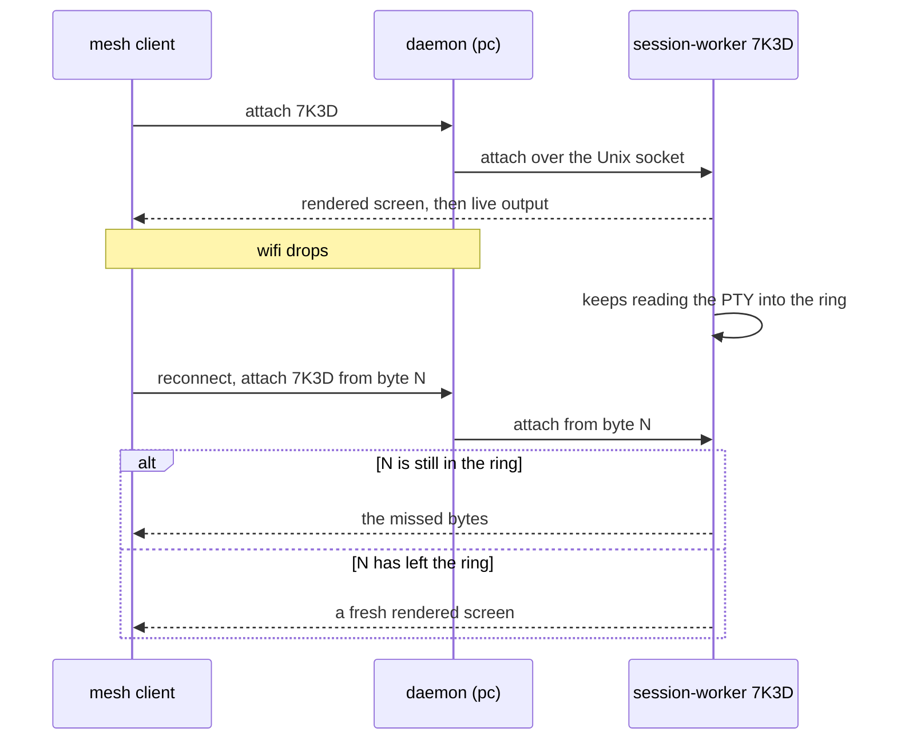

# Architecture

Mesh is built around one rule: a session belongs to its host, never to the connection that opened it. Every other choice follows from that. This page explains the pieces, how a session survives a dropped connection, and where each part lives in the code.

<picture>
  <source media="(prefers-color-scheme: dark)" srcset="../assets/architecture.dark.svg">
  
</picture>

*Clients connect straight to each host's daemon. The daemon coordinates workers, and each worker owns one session.*

## The invariants

These six rules are in `CLAUDE.md` because they are the product:

1. Connections are disposable. Sessions belong to the host, not the client.
2. Losing wifi, closing the laptop, or killing `mesh` must not kill the command.
3. A daemon crash or upgrade must not kill any session. Workers own PTYs, and the daemon coordinates.
4. Terminal traffic goes host to host. The Pi wakes and discovers, and never proxies.
5. A rebooted host reports its sessions as `interrupted`. Mesh does not pretend to resurrect RAM.
6. Each host is authoritative for its own sessions. There is no central database.

`mesh ssh HOST` is the one exception to invariant 2. It owns an ordinary process for a single SSH connection and creates no saved session.

## The parts

- **Client** (`mesh`, `mesh dashboard`): picks a host and session, attaches, sends keys, draws output. It holds no session state.
- **Daemon** (`mesh daemon`): one per host. Creates workers, finds them again after a restart, serves WebSocket and SSH, and keeps the SQLite catalog `mesh.db`.
- **Worker** (`mesh session-worker`): one per session. Owns the PTY and the process on it, a replay ring, and the rendered screen. Listens on a Unix socket in `s/<ID>/sock`.

The daemon starts each worker detached with `Setsid`. A worker writes `meta.json` into its own directory under the state directory (`~/.local/state/mesh/s/<ID>/` by default), and the daemon finds workers again by scanning that directory. We chose a directory scan over `systemd-run --scope` because macOS needs the same mechanism, so one code path serves both.

A session ID is four characters from a base-32 alphabet without `I`, `L`, `O` and `U`, so you can read one aloud.

## A session across a dropped connection

The client numbers the bytes it has received. The worker keeps recent output in a ring buffer of 4 MiB, indexed by those same absolute byte offsets, so "I have everything before byte N" is all the client has to remember.

Notice that the worker never learns the connection dropped. It only sees a client leave and, later, a client attach.

A first attach has no byte offset, so the worker sends its rendered screen. Rendering comes from a terminal emulator inside the worker, which is why reattaching to `vim` or `htop` shows the screen, not a scroll of escape sequences.

A second client that attaches to an attached session takes it over. The first client is told `stolen`. Mesh has no mirrored terminals. The terminal-window flow (`mesh --window`) never takes over silently: it offers only detached sessions.

## Surviving a daemon restart and a reboot

The daemon is a coordinator. If it owned every PTY, updating it would kill live work, so workers own them instead. After a restart the daemon scans the session directories and reconnects.

A reboot kills every process, and Mesh does not hide that. Each `meta.json` records the kernel boot ID. A session whose boot ID differs from the current one is `interrupted`. The session states are `running`, `detached`, `exited` and `interrupted`. [Recover a workspace](../guides/recovery.md) describes what you get back for an interrupted session.

State is derived, not stored. A worker whose socket answers is running. A socket that is gone with no recorded exit means `interrupted`. SQLite caches what the workers already say.

## How clients reach a host

- **Unix socket**, no port: the daemon and the local CLI talking to workers.
- **WebSocket**, port 7337, path `/mesh`: the `mesh` client between hosts. One socket carries many sessions. TLS 1.3 runs inside it, with Mesh device keys.
- **SSH**, port 2222: any SSH client. A phone with Tailscale and an SSH client is a complete Mesh client.

All three use the same frame format (`kind:1 | length:4 | payload`), defined in `internal/protocol`. The WebSocket has compression off, and the client reconnects with backoff.

Tailscale handles reachability. Mesh does not route or proxy traffic, so terminal bytes go from the client to the host. A Pi on the same LAN can wake a sleeping desktop, but it never carries the session. [Device access](device-access.md) explains how a host decides who may connect.

Port 2222 sits beside the system SSH server on 22 because a user service cannot bind a privileged port, and `mesh add` needs system SSH for recovery. See [ADR 004](../adr/004-ssh-front-door-on-port-2222.md).

## Where to read the code

- `internal/protocol`: the wire format. Transport-agnostic. A change here touches every component.
- `internal/session`: output ring, session IDs.
- `internal/worker`: `mesh session-worker`, the PTY, its socket, attach and steal, snapshots.
- `internal/terminal`: rendered screens for reattach and previews.
- `internal/daemon`: worker discovery, relay, lifecycle.
- `internal/transport`: WebSocket with reconnect and resume.
- `internal/sshd`, `internal/sshfs`: the SSH front door, read-only SFTP and SCP.
- `internal/identity`: the host key, an Ed25519 key shared by WebSocket and SSH.
- `internal/cli`, `cmd/mesh`: commands, attach, discovery.
- `internal/tui`: the picker and the dashboard.
- `internal/recovery`, `internal/agentresume`: workspace and agent conversation recovery.

## Decisions behind this shape

- [001. Workers own sessions, the daemon only coordinates](../adr/001-workers-own-sessions.md)
- [002. Sequence numbers are absolute byte offsets](../adr/002-absolute-byte-offsets.md)
- [003. One attacher per session, steal on attach](../adr/003-single-attacher.md)
- [004. SSH is a front door on port 2222, not the transport](../adr/004-ssh-front-door-on-port-2222.md)
- [005. Mesh device keys authorize network controls](../adr/005-mesh-keys-authorize-controls.md)
- [006. Hosting stays inside the tailnet](../adr/006-tailnet-only-hosting.md)
- [007. ctrl+] detaches the innermost session](../adr/007-innermost-detach-key.md)
