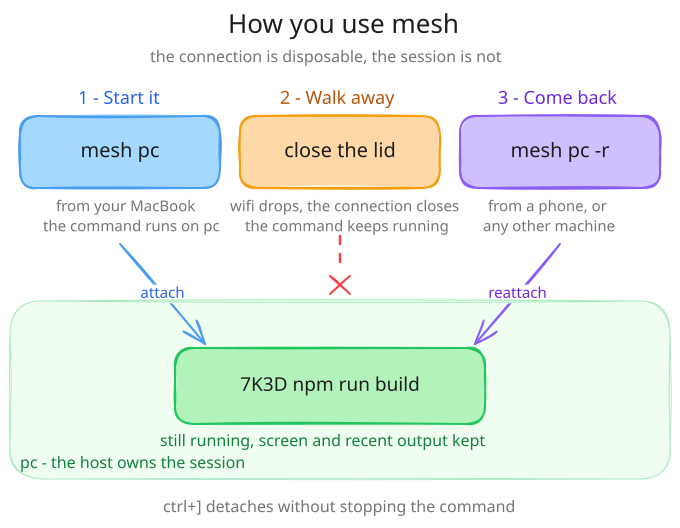

# Getting started

In this tutorial you start a session, detach from it, and come back to find the command still running. Then you do the same across two machines.

<picture>
  <source media="(prefers-color-scheme: dark)" srcset="assets/usage.dark.svg">
  
</picture>

*The connection comes and goes. The session stays on its host.*

Install Mesh first with the [quick start](../README.md#quick-start). You need Mesh on your PATH and nothing else for the first part.

## Run a command that outlives its terminal

Start a session that prints a line and then waits:

```bash
mesh local -- sh -c 'echo build finished; sleep 600'
```

```text
new session ETRG
build finished
```

Mesh prints the session ID. Yours differs. Now press `ctrl+]`:

```text
detached from ETRG, still running
```

The command runs in a worker process that Mesh started for the session. Your terminal was only a window onto it.

## Find it again

List the sessions on this machine:

```bash
mesh ls
```

```text
ID    STATE     AGE  IDLE  MEM  STARTED IN  COMMAND
ETRG  detached  2s   2s    -    /tmp        sh -c echo build finished; sleep 600
```

Read its output without attaching:

```bash
mesh logs ETRG
```

```text
build finished
```

Attach again with `-r`, which resumes the newest live session:

```bash
mesh local -r
```

Mesh prints `resuming ETRG` and redraws the screen where you left it. Detach with `ctrl+]` once more, then end the session:

```bash
mesh kill ETRG
mesh rm ETRG
```

```text
killed ETRG
removed ETRG
```

## Add a second machine

Sessions become useful when they live on a machine other than the one in front of you. You need two machines on the same tailnet, and an SSH login to the second one. The `mesh add` output is not reproduced here because this step needs a second machine.

From your laptop, adopt the machine named `pc`:

```bash
mesh add user@pc
```

`mesh add` connects over system SSH, installs Mesh there (and Tailscale if it is missing, after asking), starts the daemon, and approves this laptop for it. `pc` is the machine's name on your tailnet. [Machine names](reference/machine-names.md) explains how Mesh picks it.

Start a session on `pc`, detach, and close the laptop lid:

```bash
mesh pc
```

A session on another machine announces its host. The ID differs each time:

```text
new session EE9N on pc
```

Open any other machine that has Mesh and reattach:

```bash
mesh pc -r
```

Run `mesh` with no arguments to pick a host and session from a list instead.

## Where to go next

- Copy files: [Copy files between machines](guides/copy-files.md)
- Use a phone or any SSH client: [Reach sessions over SSH](guides/remote-access.md)
- Keep Claude Code and Codex conversations across crashes: [Recover an exact Codex or Claude conversation](guides/agent-recovery.md)
- Understand the moving parts: [Architecture](concepts/architecture.md)
- Something failed: [Troubleshooting](troubleshooting.md)
